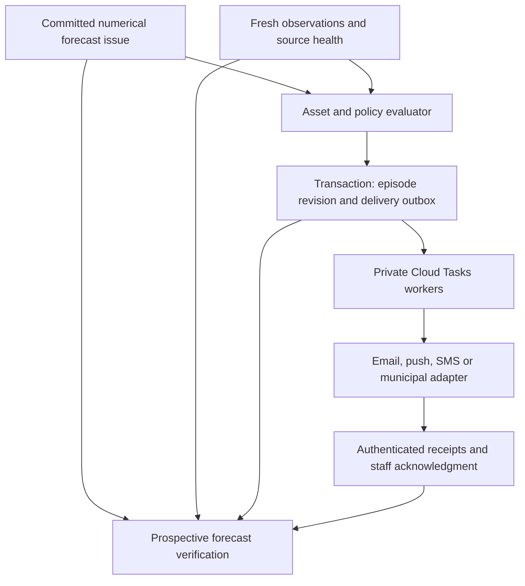

# FloodCast alerting and commercialization plan

Date: October 17, 2026. Status: proposed product and implementation plan, not deployed functionality. Scope: add municipal subscriptions and direct citizen subscriptions to the existing Firebase/Ionic app, establish prospective accuracy measurement, and validate commercial value before expanding the sensor network.

## 1. Product decisions

Build one alert engine with two customer experiences:

| Offering | Initial value | Distribution |
| --- | --- | --- |
| Citizen subscription | Watch a few named places, receive advance flood advisories and material updates, review alert history. Test the proposed $1/month price, with $12 annual billing offered clearly. | Verified opt-in email and push; optional separately priced or sponsored SMS. |
| Municipal subscription | Monitor approved infrastructure/assets, staff alerts and acknowledgment, public-message approval, audit trail and performance reports. | Staff email and one integration selected with the pilot town; SMS for tested staff escalation if needed. |
| Municipality-sponsored citizen access | Eligible residents receive the citizen features funded by their town. | The same citizen channels and preferences; no second fee for the same covered service. |

Keep the public dashboard available as a useful discovery and reference surface. Individual subscriptions do not require a town to become a customer first. Pilot citizen advisories alongside municipal staff alerts once shared quality/delivery gates pass. Official municipal messages remain a distinct issuer and approval workflow.

The paid product is advance notice for places that matter, dependable updates, and a record of what happened. Gemini is optional explanation; all eligibility, timing, severity and delivery decisions are deterministic calculations.

## 2. Reuse and current gaps

Existing foundations, verified in source:

- `functions/src/forecast/jobs.ts`: scheduled forecasts every 10 minutes, immutable issued-input snapshots and forecast archives, current shared public outlook.
- `functions/src/forecast/water.ts`: datum-aware calculations and threshold crossings, with explicit gaps, clipped starts and unknown end times.
- `functions/src/health.ts`: independent gauge, NOAA, forecast and model freshness checks.
- `functions/src/forecast/eventEvaluation.ts`: point, peak, crossing and event replay helpers. Its legacy window scores/nearest-peak matcher are not a complete prospective unique-event evaluation system.
- `src/types/user.ts` / `firestore.rules`: Firebase authentication and existing app roles. These roles do not provide municipal organization isolation.
- Source caching, diagnostics and private forecast/model archives already exist.

Not implemented today: organization membership, asset alert policies, citizen watchlists/verified notification channels, subscriber billing/entitlements, a delivery outbox/queue, municipal approvals, provider delivery callbacks, and an automated prospective forecast scorecard.

Keep Carolina Beach as the first supported location. Correct the station-only cache identity before any second location shares its NOAA station. Consolidate physical location references progressively; do not require a national platform rewrite for the first pilot.

## 3. Turn local observations into an asset register

Preserve existing manual map tuning as a versioned input. Do not blanket-replace it with raw elevation data.

Start with a small reviewed set of places: road crossings, public parking areas, access points or municipal assets for which existing observations are useful. Each record needs:

- Stable place/asset identity, geometry, responsible reviewer, public/private designation and timezone.
- Gauge identity, astronomical station, units, datum/epoch and reference/calibration version.
- Threshold basis: an observed impact trigger, a municipality-selected operational action level, or surveyed elevation. These are separate quantities.
- Evidence: time-stamped photo/camera/staff report, wet/dry condition, approximate onset/end, corresponding original gauge samples, known rainfall/drainage conditions and review quality.
- Threshold/action description, supported hazards, limitations, approved forecast horizon and last review date.

Your observations can support empirical impact thresholds without a surveyed depth at every point. Preserve uncertainty and evidence count. A camera normally proves water presence better than exact depth unless a calibrated marker is visible. A pump-action level is an operational policy, not proof that a road has a particular water depth.

Review questionable map points first: missing-elevation defaults, drainage connectivity, road crown assumptions and inconsistent datum metadata. Do not use an unreviewed map color as a citizen alert trigger. A generic threshold exceedance must not be presented as measured street depth. Road reopening requires appropriate municipal confirmation.

## 4. Alert behavior

Maintain distinct forecast, observation, municipal operational and delivery states. A level predicted above a gauge trigger is not automatically confirmed road flooding.

| Event | Proposed behavior |
| --- | --- |
| First supported predicted exceedance | One advance advisory with place, expected window, relevant trigger, issue/update time and confidence/quality label. |
| Event approaches a selected useful lead time | Reminder if enabled and still supported by a fresh forecast. |
| Material timing/peak/severity change | Update the existing episode; summarize what changed. Do not send every 10-minute recalculation. |
| Fresh forecasts remove an exceedance | “Forecast revised lower / predicted exceedance removed.” Preserve history; do not call this observed recovery. |
| Fresh gauge exceeds an approved trigger | “Gauge above the place's alert threshold.” Use “street flooding confirmed” only with supported local evidence. |
| Gauge/forecast fails freshness or compatibility checks | Mark risk unresolved/data unavailable, alert operators, suspend unsupported new numerical claims. Never clear an active risk because data stopped. |
| Reliable observations satisfy recovery criteria | “Water level below trigger / conditions easing,” with its evidence. This does not certify road access. |
| Authorized municipality confirms an operational change | A separately attributed road-closure/reopening or municipal instruction. |

Use stable episode IDs across moving forecast crossing times. Match the continuing tidal/event interval and handle split/merge cases; predicted start-time strings alone are not stable IDs. Maintain versioned, configurable material-change tolerances, recovery hysteresis and persistence. Set them with pilot users and replay evidence, without inventing physical severity thresholds. Urgent supported observed escalation must not be delayed by nonessential anti-noise rules.

Support long-range planning notices separately from actionable short-range alerts. Select eligible leads using the eventual scorecard and policy; current `available` status is not sufficient proof of alert reliability. Historical error envelopes are not calibrated flood probabilities. Do not show an invented percentage confidence or infer safety from a centerline below threshold.

## 5. Citizen subscription experience

A compact flow in the existing app:

1. Tap **Get flood alerts** and choose a supported public place/zone.
2. See what that place's alert can and cannot establish, supported horizons and current data health.
3. Choose advance-advisory/reminder/update preferences and channels; confirm email/device. No background GPS is required for saved places.
4. Preview a clearly marked test message. A paid flow must tell the user if push is unavailable/denied and provide a tested alternative before implying alerts work.
5. Choose $1 monthly or $12 yearly if both are enabled, showing the total, renewal and cancellation terms clearly. Complete hosted checkout.
6. Show **Alerts active**, watched places, verified channels, next relevant outlook and recent alert history. Include **Send test**, **Pause alerts**, **Manage billing** and **Cancel renewal**.

Pausing/unsubscribing from messages and cancelling billing are distinct actions; explain their effects. Expiry/payment failure must create an honest inactive state, not a silent claim that alerts continue. Never suppress free official/public information through paid entitlements. If a municipality sponsors the same place/service, disclose eligibility, prevent double charges and offer a clear transition for an existing individual subscriber.

Define entitlement transitions during an active episode. Proposed pilot policy: a short, disclosed grace for follow-up updates to an already-issued episode after paid access expires, bounded by episode/message expiry and always respecting channel opt-out. Cancellation of renewal normally preserves access through the paid term; no new subscription claim should imply otherwise. Sponsorship is scoped per place/service, so covering one watched zone does not silently change unrelated paid coverage. Publish the effective-date and prepaid annual credit/refund policy before launch; do not charge twice for the same covered service.

Direct citizen messages identify FloodCast as issuer. Municipality-issued messages name the municipality and approved revision. Independent subscriber advisories need not wait for a municipal approver; official public notices do. Initial municipal citizen distribution should feed its existing platform, subject to confirmed integration access, rather than import the entire resident directory.

## 6. Municipal workflow

Add an organization-scoped workspace with asset/zone list, current status, pending/active episodes, deliveries, staff acknowledgments and an accuracy report. Suggested roles: viewer, operator, public-message approver and organization administrator. These are separate from FloodCast's global administrator role.

Staff configure approved asset policies and recipient/on-call groups. A publisher sees the exact message, affected zone, evidence, forecast age and changes before approving a public notice. Approval belongs to an immutable message revision and expires on a material change. Record who approved, sent, acknowledged and confirmed an operational action.

For the pilot, integrate one actual municipal notification system chosen during discovery. A signed webhook/export can be the first adapter; do not promise a specific vendor API without confirming that the town's contract allows it. Public IPAWS/WEA origination is not needed to launch opt-in advisories or staff alerts; municipal emergency-warning authority is a separate responsibility [S5].

## 7. Firebase architecture

Suggested bounded modules under `functions/src/alerts/`, `functions/src/verification/` and `functions/src/billing/`; dashboard/user interfaces can reuse current Ionic routing/authentication. No service-account private key enters the app. Provider secrets stay in managed server secrets.

Private data model (final schema to be specified during implementation):

| Entity | Purpose |
| --- | --- |
| `organizations/{id}/members/{uid}` | Organization roles and active membership. |
| Organization assets/policies | Private infrastructure, thresholds, routing, approved actions and versions. |
| Public monitored-place projection | Only approved nonsensitive place metadata for citizen watchlists. |
| User alert preferences / verified endpoints | Saved places, consent, channel state, quiet hours and test status. No public phone lists/tokens. |
| Billing accounts / entitlements / sponsorships | Server-owned paid access and municipal coverage. |
| Episodes and immutable revisions | Stable event identity, issuer, evidence and policy/calibration snapshot. |
| Delivery outbox / attempts / receipts | Deterministic delivery IDs and honest queued/accepted/delivered/failed/expired/unknown state. |
| Observation-event ledger / verification records | Versioned truth and forecast/alert scores without recipient PII. |
| Audit records | Append-only configuration, approval and operational decisions. |

The public `locations/*` namespace intentionally exposes environmental information; never put contacts, payment identifiers, private infrastructure or raw recipient lists there. Enforce ownership/organization checks in both Firestore rules and server handlers; Admin SDK workers bypass client rules. Limit who can edit approved thresholds, publish notices and configure outbound destinations. Audit member removal and revoke future delivery/access promptly.

### Reliable evaluation and sending

- Publish the immutable numerical issue, current pointer and readiness marker atomically, with an explicit commit/publication timestamp. The present sequential writes should not expose a half-published issue to alert workers. Keep optional later explanation records issue-scoped without rewriting archived numerical values.
- Consume a committed immutable numerical issue with explicit publication time and ordered revision. Do not allow Gemini latency/failure to block alert decisions; optional explanations can follow independently.
- Atomically create episode revisions and outbox intents. Never send a message inside a Firestore transaction.
- Deliver asynchronously through private Cloud Tasks functions with bounded retry/rate limits. Firestore trigger order is not guaranteed and duplicate invocation is possible; ignore older revisions and make repeated processing idempotent [S1–S2].
- A scheduled reconciler repairs the commit-to-enqueue gap and alerts on stuck deliveries.
- Before every send, recheck current revision, eligibility, subscription/sponsorship, active consent, expiry, supersession and permitted channel. Obsolete reminders must not arrive after an event ended.
- Use deterministic delivery IDs and provider idempotency where supported. If a provider accepts a send and the worker crashes before saving the receipt, record/reconcile the ambiguous state rather than promise universal exactly-once sending.
- Authenticate/deduplicate provider callbacks and payment webhooks; reconcile out-of-order events against authoritative provider state. Do not trust the checkout success URL or a client-side paid flag.
- Record acceptance, reported delivery and human acknowledgment separately. Push/message submission is not proof that someone received or read it; set expiry explicitly so stale warnings cannot wait for the default long push lifetime [S3–S4].
- Keep critical numerical fields and approved instructions in versioned templates. Do not call Gemini once per recipient.

## 8. Accuracy tracking is part of the product

Track three separate claims:

1. **Forecast skill:** did the saved physical water-level forecast match the measured gauge?
2. **Alert performance:** did the actual policy identify the event and deliver useful notice in time?
3. **Asset-impact accuracy:** did flooding occur at the named place? A gauge alone does not establish street depth or drainage conditions.

An operational scorecard should report:

| Measure | Decision supported |
| --- | --- |
| Unique observed events detected and missed | Whether the service warns about the impacts people experience. |
| False-alert share, false-positive rate and updates per episode | Alert fatigue; retain their different denominators. |
| First warning lead time | How much useful preparation time the decision and actual delivery provided; separate publication, decision and delivery. |
| Peak error/bias/underprediction and onset/duration error | Water-level/action timing quality, including early versus late bias and sampling uncertainty. |
| Data/forecast/service availability | How often the service could assess risk; include outages and actual fallbacks. |
| Empirical error-envelope coverage and width | Whether historical bounds describe future errors, by lead. No probability score until genuine probabilities exist. |
| Delivery/acknowledgment outcomes and latency | Whether the communications layer worked. Delivery is not reading or action. |
| Staff/citizen reported usefulness and operational action | Whether the service changes decisions; do not invent avoided-loss dollars. |

### Prospective scorer

- Read archived forecasts and issued input/model snapshots. Never regenerate an old forecast with subsequently available weather, observations, coefficients or revised calibration.
- Add explicit publication/commit time. Existing `generatedAt` can precede actual availability because publishing follows archiving/explanation. For older issues, archive creation time can be a conservative availability bound; flag that limitation.
- Predeclare hourly evaluation origins using the last issue publicly available at/before that time; retain all ten-minute issues diagnostically. Evaluate target-minus-publication leads such as 1/3/6/12/24/48/72h, with separate longer-range planning cohorts where supported. Record sensor age separately.
- Construct a continuous compatible observed-event ledger with stable IDs, original measured samples, crossing brackets, peaks, gaps, clipped boundaries and revisions. Half-hour observations do not provide observed minute-level crossing certainty.
- Report new-onset/dry-at-publication cohorts separately from floods already underway. For advance-warning scoring, record decision/first advisory/delivery relative to observed onset, retain late/no-warning and undelivered outcomes, and show their counts beside every lead-time summary. An alert issued while already flooded is a useful current-condition notification, not successful advance warning.
- Evaluate predetermined dry and flooded windows plus unique observed episodes. A flood appearing in many successive issues is not many independent floods. Use event/day blocks when estimating uncertainty.
- Keep the old evaluator for historical comparability. Add a versioned deterministic one-to-one event matcher requiring declared interval overlap/timing tolerance; the existing greedy nearest-peak-within-three-hours matcher can pair disjoint events. Fix tolerances before reviewing results.
- Compare astronomical tide, issue-time residual persistence, the actual served model/fallback, and compatible archived official total-water guidance on common support. Do not compare against a newer official forecast or score only the easy common subset as whole-service performance.
- Store issue/publication/origin timestamps, actual daily model identity, code/config/calibration/threshold/policy versions, method/tail/weather support, target/lead, forecasts/truth/support/exclusions, event outcomes and delivery evidence. Missing outcomes remain null with reasons.
- Missing observations are unknown, not dry. Exclude unsupported numerical truth but disclose coverage. Missing forecasts remain failures/unavailability in service reporting, even when no numerical MAE can be computed.
- Start internally; publish customer scorecards with sample counts, dates, lead, location and limitations once support is adequate. Daily coefficient refits remain prospective only if the frozen procedure and each model version are archived. A new approach selected after examining results starts a new evaluation cohort.

The release gate is not an invented “95% accurate” number. Agree acceptable missed events, false alerts, useful lead time and coverage with the pilot before scoring. A short quiet trial cannot establish storm/annual reliability. Threshold alerts can be useful with empirical gauge/impact evidence before precise street-depth claims are available.

## 9. Citizen price and channel economics

The proposed $1/month price is a testable entry point, not established willingness to pay. Offer annual billing clearly rather than silently changing the user's intended price.

Using the published standard US domestic-card example of 2.9% + $0.30 per charge [S7]:

| Billing | Approximate revenue after card processing, per subscriber/year |
| --- | ---: |
| $1 each month | $8.04 |
| $12 once per year | $11.35 |

Per-charge rounding is included. This excludes Stripe Billing, taxes, refunds/disputes, hosting, weather data, messaging, acquisition and support. Stripe Billing's published pay-as-you-go rate adds 0.7% of billing volume [S8]. These are illustrative published-rate economics, not verified account-specific charges or a profit forecast.

Start the citizen tier with push/email and a small number of watched places. Push remains a best-effort channel with verified fallback, not guaranteed instant delivery. SMS should be a separately priced/limited opt-in add-on or municipality-funded channel. Current Twilio US pricing starts at $0.0083 per outbound segment plus carrier and other applicable fees; multiple message segments and event updates can consume a material share of $1 [S9]. Do not advertise unlimited SMS without measured worst-period costs.

Share numerical inference per location rather than per subscriber. Track cost per paying user, notification segment, supported location and municipal account. Model fanout as recipients × messages per episode × episodes, with storm/busy-season cases. Choose an annual municipal subscription plus a scoped onboarding/calibration fee; price staff features/coverage/integrations and any sponsored communication allowance. Determine dollar amounts with the pilot's actual service burden. Manual invoicing is sufficient initially; a municipal self-service billing suite is not a prerequisite.

Use hosted web checkout and billing management for the first web pilot. Native-store purchases need a separate platform-rule/fee review when introduced. Keep payment-card handling at the payment provider. Subscription validation, webhook replay handling, cancellation/renewal/failed-payment logic and sponsorship overlap belong server-side.

## 10. Implementation phases and exits

| Phase | Build | Exit evidence |
| --- | --- | --- |
| A — Evidence and preparation | Review a small set of places, preserve manual calibration evidence, explicit publication/version metadata, prospective scorer, pilot operating policies. | Known reference compatibility; traceable thresholds; scorecard runs without inventing truth; source latency measured. |
| B — Shared engine in shadow mode | Deterministic episode evaluator, material-change rules, private outbox/queue, expiry/reconciliation, test-only destinations. | Replays handle duplicates, out-of-order issues, split/merge, gaps, stale sources and corrections; no accidental public sends. |
| C — Citizen and municipal pilots | Citizen watchlist, verified email/push, test alerts, $1/month and/or $12/year checkout experiment; one municipal staff workspace and selected delivery adapter. | Consenting real recipients receive tests and measured supported advisories; billing/access state is correct; staff/citizens report useful lead time. No municipal contract required for individual participation. |
| D — Municipal public distribution and refinement | Approved public-message revisions/zones, integration with town tools, sponsored resident access, bounded SMS if justified. | Authority/approval, accessibility, opt-out and delivery-failure workflows verified; measured scorecard and support plan accepted. |
| E — Additional locations/sensors | Generalized reference registry, location/gauge cache isolation and per-location models/health; add hardware only for demonstrated blind spots. | Repeatable onboarding and a specific unmet coverage/latency/physical-reference need that existing inputs cannot resolve. |

These are dependency phases, not calendar or accuracy guarantees. Run customer discovery and commercial data-access discussions alongside A/B. A limited pilot can proceed before a full seasonal record if its claims, horizons, limits and recipient expectations match the available evidence. Broad reliability promises require broader prospective evidence.

### Tests and release evidence

- Atomic state/outbox; duplicate and out-of-order issue processing; stable episodes across shifted crossings; split/merge; escalation and recovery hysteresis; missing/end-clipped windows.
- Stale/OOD weather or gauge failures never manufacture a safe state or fresh forecast; independent health and stuck-outbox alarms work.
- Queue retry, accepted-send/crash ambiguity, old approval, supersession, expiry, revoked consent/member, duplicate callbacks and provider failures.
- Municipal integration destinations are HTTPS-only, with private/link-local/metadata endpoints blocked, controlled redirects, verified destination ownership, secret rotation and signed-message replay defense.
- Cross-organization/private contact access denied, including Admin SDK endpoint authorization; sender/integration secrets never enter public documents or bundles.
- Payment webhook signature, duplicate/out-of-order events, renewal/cancel/expiry/refund policy, entitlement reconciliation and no duplicate sponsorship charge.
- Channel permission denial, token expiry, bounce/STOP/unsubscribe, DST/midnight, quiet hours, accessible forms/summaries and non-color status information.
- Real end-to-end tests use specifically consenting recipients; provider acceptance, delivery evidence and acknowledgment are checked separately. Record test messages distinctly from resident incidents and scorecards.
- Prospective evaluation fixtures preserve issue-time availability, baseline inputs, quality gaps, unique-event counts and immutable score versions.

## 11. Commercial readiness before more hardware

Prioritize: a named initial buyer/use case, reviewed local impact evidence, useful/reliable alerts, honest public claims, a prospective scorecard, secure organization separation, tested support/outage ownership, accessible mobile flows, commercial data rights and measured delivery economics.

Municipal web/mobile procurement should include an accessibility assessment and remediation status. DOJ guidance covers contracted municipal services and WCAG 2.1 AA [S6]; do not claim conformance from an automated score. Confirm customer-approved data retention/export, public-record handling and privacy responsibilities without assuming every asset or recipient list can be published. Final procurement/contract terms need the appropriate customer/business review.

Validate customer value using opt-in conversion, actual alert delivery/usefulness, cancellations/renewals, support effort, municipality staff decisions and cost to serve. Low price alone does not establish demand; ongoing annual renewal cannot be proven during a short pilot. Avoid claiming prevented losses without evidence.

Add a new sensor when evidence identifies a distinct basin/drainage blind spot, inadequate source cadence, no compatible observation, or unacceptable local spatial transfer. More hardware does not resolve an unmeasured notification or business-model problem.

## Sources checked October 17, 2026

- S1: [Firebase task queue functions](https://firebase.google.com/docs/functions/task-functions).
- S2: [Firestore trigger limitations](https://firebase.google.com/docs/functions/firestore-events) and [transactions](https://firebase.google.com/docs/firestore/manage-data/transactions).
- S3: [FCM message lifetime and acceptance versus delivery](https://firebase.google.com/docs/cloud-messaging/customize-messages/setting-message-lifespan).
- S4: [Twilio delivery statuses](https://www.twilio.com/docs/messaging/api/message-resource) and [messaging consent policy](https://www.twilio.com/en-us/legal/messaging-policy).
- S5: [FEMA alerting-administrator training](https://emilms.fema.gov/is_0251b/assets/5555DCE3-A5A7-BBB1-50B4-98B2E7934B31.pdf).
- S6: [DOJ municipal web/mobile accessibility guidance](https://www.ada.gov/resources/web-rule-first-steps/).
- S7: [Stripe standard US payment pricing](https://stripe.com/us/pricing).
- S8: [Stripe Billing pricing](https://stripe.com/billing/pricing).
- S9: [Twilio US SMS pricing](https://www.twilio.com/en-us/sms/pricing/us).
- S10: [Open-Meteo commercial hosted-service pricing](https://open-meteo.com/en/pricing). Confirm commercial service/attribution and Sunny Day camera/sensor permissions before charging; public access alone is not a commercial service agreement.

Current implementation references: `functions/src/forecast/jobs.ts`, `functions/src/forecast/eventEvaluation.ts`, `functions/src/forecast/water.ts`, `functions/src/health.ts`, `functions/src/locations.ts`, `src/types/user.ts`, `src/components/Tab2/hooks/useChartData.ts`, `firestore.rules`, and the existing forecasting/validation documents in this directory. No alert, billing or public-message functionality was implemented or deployed as part of this planning task.
